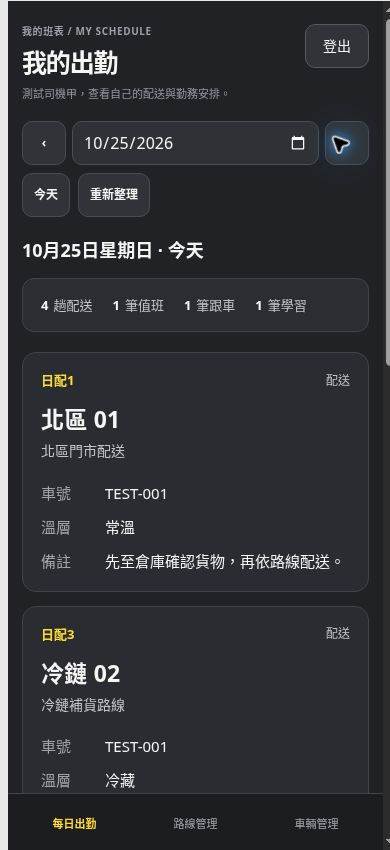

# Increment 1.4.21 — mobile logout and driver attendance

Drivers now see only their own deliveries, 值班、跟車、學習 and leave for the selected date. Their attendance screen has a date picker, previous/next day, today and refresh controls, followed by vertically stacked cards on phones and two columns on larger screens. Cards show the route, vehicle, temperature and notes where applicable. Long notes wrap. Empty, leave, loading and retry states are explicit; a slower date request cannot overwrite a newer selection.

Driver attendance is read-only. Drivers cannot add, edit, remove or request changes. The supervisor company table, templates, direct editing, leave and close/reopen controls remain available; the obsolete approval button is removed. The old `driver.html` bookmark redirects to current attendance. Existing historical request rows remain stored.

All five dashboards have a visible mobile 登出 control. Desktop and mobile buttons use the same sign-out handler, prevent duplicate submission, return to login on success and show a retry message on failure. The driver desktop sidebar remains visible while the card list scrolls.

## Server enforcement

- Restrictive RLS limits attendance reads to the signed-in driver; supervisors retain company-wide reads.
- Standby/duty RPCs filter by the same identity. Driver day-state responses contain only the date and closed flag; company snapshots and approval history are supervisor-only.
- Driver mutations are blocked both by table permissions/RLS and by guards covering legacy SECURITY DEFINER writers. Retired request/review/completion endpoints are no longer executable by browser roles.
- Browser roles lose table-level TRUNCATE/TRIGGER privileges on attendance tables. Supervisor application operations continue through existing authorized RPCs.
- The migration requires zero pending requests. It changes no operational rows, identities, payroll amounts or closed snapshots.

The migration source is `20261023114454_increment_1421_driver_readonly_attendance.sql`; the live installation version is `20261023120014`. See `DATABASE.md` before any future migration rollout.

## Verification

- Existing automated regression suite passed, including payroll, retained snapshots after reopening, phone login, route permissions and account management.
- 28 new isolated database checks passed against the real schema. They cover own-row reads, RPC filtering, denied driver writes, retired endpoints, historical data preservation, and supervisor edit/close/reopen behavior.
- 24 new UI checks passed: driver routing and cards, own-data query scopes, escaped notes, cancellation/leave/empty states, failed refresh and recovery, date races, legacy editor denial, logout concurrency/error handling, and the retained supervisor board.
- Portable schema restoration and all 26 offline demonstration checks passed. Static deployment excludes tests, migrations, credentials and local QA pages.
- Browser inspection used fictional data with the production attendance scripts/styles at phone and desktop widths. At 320/390 pixels, the driver document had no horizontal overflow; at 1280 pixels it used two card columns. Mobile logout measured 64 × 44 pixels. The supervisor table and controls remained present.
- Live read-only checks under Brian, a supervisor and all three current driver identities confirmed that supervisors retain company reads and drivers see zero other-driver attendance rows or privileged RPC records. No real account password was used and no live attendance was edited for testing.
- Before/after checksums matched across 12 attendance/history tables. Supabase security advisory comparison introduced no new findings; existing advisories are unchanged except three retired callable functions no longer appearing.

Google Play packaging remains paused at the user’s request. This release updates the existing web system only.

Mobile preview using fictional records:

