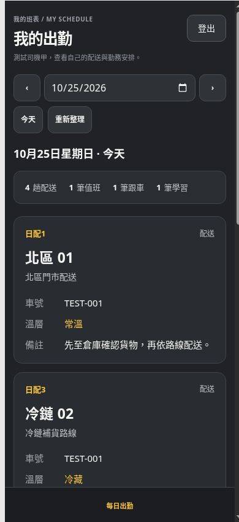

# Increment 1.4.22 — logo, yellow and driver navigation

The system uses the supplied `logistics-dispatch-logo(3).svg` unchanged as `assets/tangguanjia-logo.svg`, including the white arrow and dot. Its yellow, **#FFC533**, is the shared interface accent. Login, dashboard branding and favicons use the new SVG; current page assets carry the 1422 cache version. Muted backgrounds and semantic warning colors retain their existing roles.

Driver attendance cards display 溫層 values such as 常溫 and 冷藏 in the shared yellow. Driver desktop and mobile navigation contain 每日出勤, with 登出 available in the sidebar or mobile header. 路線管理 and 車輛管理 links remain visible to active supervisors. Management links stay hidden while the authenticated profile loads.

This is a frontend release with no database migration or operational-data changes. The own-record, read-only driver access rules from 1.4.21 remain enforced by the backend. Google Play packaging remains paused.

## Verification

- Build and static asset/link checks passed.
- The complete automated regression suite, portable schema restoration and all 26 offline demonstration checks passed.
- Browser checks used fictional fixtures with production scripts and styles. At 390 pixels, the driver document had no horizontal overflow and only 每日出勤 appeared in mobile navigation. At 1280 pixels, the two-column cards and attendance-only sidebar remained intact.
- The computed temperature text color was `rgb(255, 197, 51)` (#FFC533). Supervisor route and vehicle links remained visible.
- The deployed SVG is byte-for-byte identical to the supplied attachment.
- The standard GitHub Actions workflow runs the complete regression, schema restoration and offline demonstration checks before deploying this release.

Mobile preview using fictional records:

